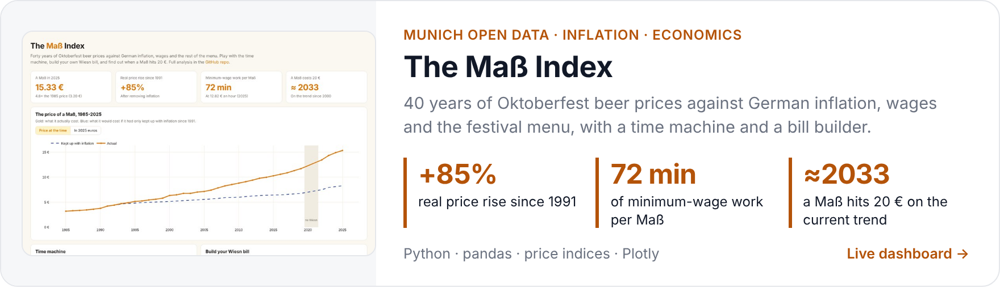

### Hello, 你好! I'm Xinyang ヾ(•ω•`)o

*I'm a **data analyst in Munich** who likes finding **the story in everyday numbers**: what a Maß really costs, how much rain keeps the city's cyclists at home, and what tourists complain about in four languages.*

*By day I build **BI reporting** with **Power BI, SQL and Python**. Most recently I owned the sales reporting for **Capgemini**'s commercial team in Paris.*

*📍 **China → Taiwan → France** (Bordeaux · Toulouse · Paris) **→ Munich** 
A **finance** degree, a **data science** master's, four years in France, and now learning German one Maß at a time.*

***Currently:** learning **German (B1)** · building a **customer-retention project** · open to **Data / BI Analyst roles** in Munich*

 

<picture>
  <source media="(prefers-color-scheme: dark)" srcset="assets/cards/impact-dark.png" />
  
</picture>

### Projects

*Each one has a **live dashboard** you can click around in, and a **notebook** that walks through the analysis.*

<a href="https://hakowxy.github.io/wiesn-mass-index/">
  <picture>
    <source media="(prefers-color-scheme: dark)" srcset="assets/cards/mass-dark.png" />
    
  </picture>
</a>

[Live dashboard](https://hakowxy.github.io/wiesn-mass-index/) · [Code & analysis](https://github.com/hakowxy/wiesn-mass-index)

<a href="https://hakowxy.github.io/munich-airbnb/">
  <picture>
    <source media="(prefers-color-scheme: dark)" srcset="assets/cards/airbnb-dark.png" />
    
  </picture>
</a>

[Live dashboard](https://hakowxy.github.io/munich-airbnb/) · [Code & analysis](https://github.com/hakowxy/munich-airbnb)

<a href="https://hakowxy.github.io/munich-cycling/">
  <picture>
    <source media="(prefers-color-scheme: dark)" srcset="assets/cards/cycling-dark.png" />
    
  </picture>
</a>

[Live dashboard](https://hakowxy.github.io/munich-cycling/) · [Code & analysis](https://github.com/hakowxy/munich-cycling)

<a href="https://hakowxy.github.io/retail-sales-analytics/">
  <picture>
    <source media="(prefers-color-scheme: dark)" srcset="assets/cards/retail-dark.png" />
    
  </picture>
</a>

[Live dashboard](https://hakowxy.github.io/retail-sales-analytics/) · [Code & analysis](https://github.com/hakowxy/retail-sales-analytics)

***From my master's*** *(team projects with companies, code not public)*

- *Sales forecasting for **Pierre Fabre** across **16 countries** with **SARIMA and XGBoost**. Our team won the **Best Model Award*** (๑•̀ㅂ•́)و✧
- *An **LSTM model** for **APEM** that predicts operation times in manufacturing sequences.*
- *A skincare advice **chatbot** built with **Copilot Studio and Python**.*

***Just for fun:*** *[mood jukebox](https://mood-jazz-jukebox-pj9fzgvsfxyczs7aerxtxm.streamlit.app/), a little **Streamlit app** that picks jazz, lo-fi or city pop for your mood and where you're listening ([code](https://github.com/hakowxy/mood-jazz-jukebox))* ♪

### How I work

- ***I check the data before I trust it.*** *Every project starts with what's broken in the source.*
- ***I use the simplest model that works***, *and I say when it doesn't.*
- ***Every chart should answer a question*** *someone actually asked.*

### Toolbox

***Tools:*** *Power BI (DAX, Power Query), SQL, Python (pandas), R, Tableau, Excel, Azure ML, Dataiku, Spark, Salesforce*

***Certifications:*** *Power BI Data Analyst (PL-300), Azure Data Scientist (DP-100), Tableau Desktop Specialist, SAS Certified Data Scientist*

***Languages:*** *Chinese (native), English, French, German (B1, still learning)* (・ω・)

*I can work in Germany **without visa sponsorship**. Feel free to reach out!*

[LinkedIn](https://www.linkedin.com/in/xinyang-m-122844288/) · [xinyangma18@gmail.com](mailto:xinyangma18@gmail.com)
