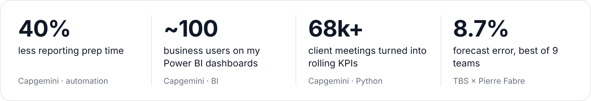
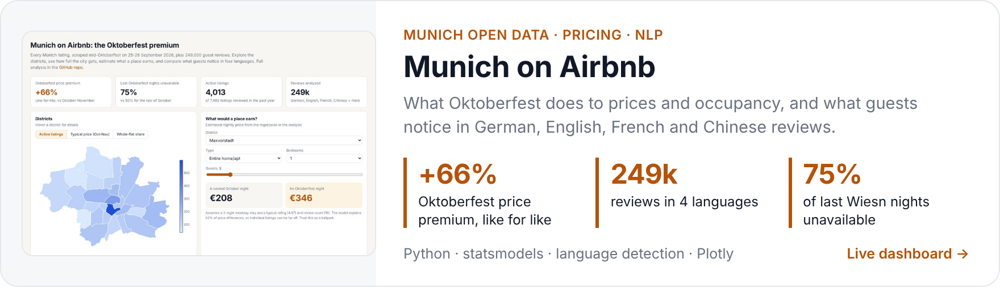
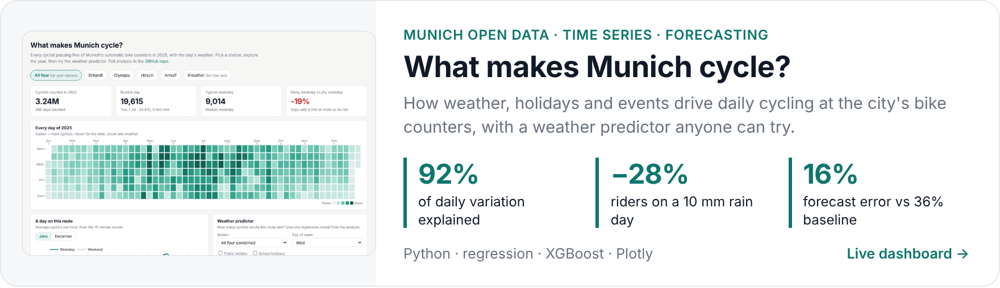
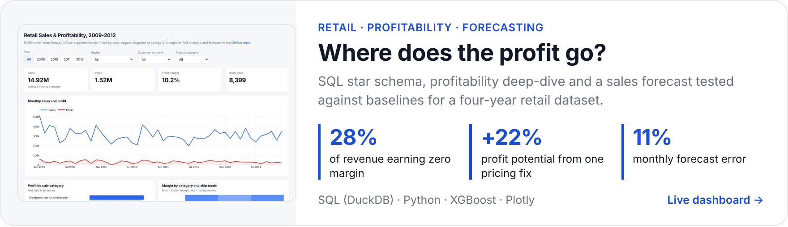

### Hi, I'm Xinyang ( ´ ▽ ` )ﾉ

Data analyst based in Munich. I mostly work with Power BI, SQL and Python, building reporting that sales and finance teams rely on every week.

Until recently I was at Capgemini in Paris, where I owned the sales reporting for the commercial team. I built five Power BI dashboards and replaced a lot of manual Excel work with Power Query, DAX and a pandas pipeline.

Before that I studied finance and economics, then did an MSc in Data Science & AI at TBS Education.

 

<picture>
  <source media="(prefers-color-scheme: dark)" srcset="assets/cards/impact-dark.png" />
  
</picture>

### Projects

Each one has a live dashboard you can click around in, and a notebook that walks through the analysis.

<a href="https://hakowxy.github.io/munich-airbnb/">
  <picture>
    <source media="(prefers-color-scheme: dark)" srcset="assets/cards/airbnb-dark.png" />
    
  </picture>
</a>

[Live dashboard](https://hakowxy.github.io/munich-airbnb/) · [Code & analysis](https://github.com/hakowxy/munich-airbnb)

<a href="https://hakowxy.github.io/munich-cycling/">
  <picture>
    <source media="(prefers-color-scheme: dark)" srcset="assets/cards/cycling-dark.png" />
    
  </picture>
</a>

[Live dashboard](https://hakowxy.github.io/munich-cycling/) · [Code & analysis](https://github.com/hakowxy/munich-cycling)

<a href="https://hakowxy.github.io/retail-sales-analytics/">
  <picture>
    <source media="(prefers-color-scheme: dark)" srcset="assets/cards/retail-dark.png" />
    
  </picture>
</a>

[Live dashboard](https://hakowxy.github.io/retail-sales-analytics/) · [Code & analysis](https://github.com/hakowxy/retail-sales-analytics)

**From my master's** (team projects with companies, code not public)

- Sales forecasting for Pierre Fabre across 16 countries with SARIMA and XGBoost. Our team won the Best Model Award (๑•̀ㅂ•́)و✧
- An LSTM model for APEM that predicts operation times in manufacturing sequences.
- A skincare advice chatbot built with Copilot Studio and Python.

### Toolbox

**Tools:** Power BI (DAX, Power Query), SQL, Python (pandas), R, Tableau, Excel, Azure ML, Dataiku, Spark, Salesforce

**Certifications:** Power BI Data Analyst (PL-300), Azure Data Scientist (DP-100), Tableau Desktop Specialist, SAS Certified Data Scientist

**Languages:** Chinese (native), English, French, German (B1, still learning (・ω・))

I'm looking for data analyst or BI roles in Germany and can work without visa sponsorship. Feel free to reach out!

[LinkedIn](https://www.linkedin.com/in/xinyang-m-122844288/) · [xinyangma18@gmail.com](mailto:xinyangma18@gmail.com)
